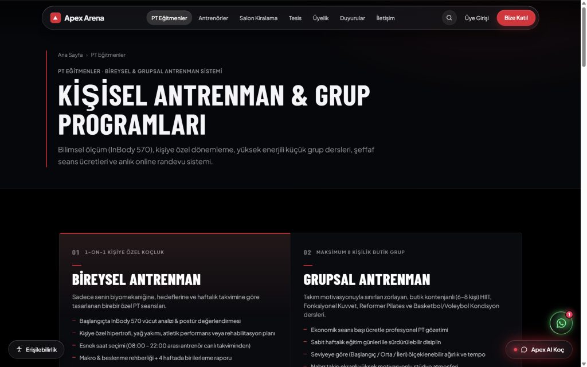
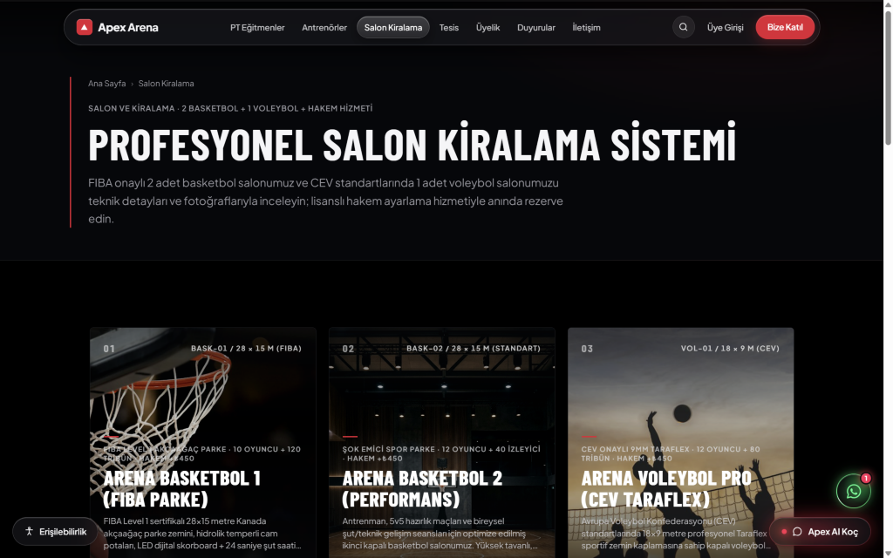
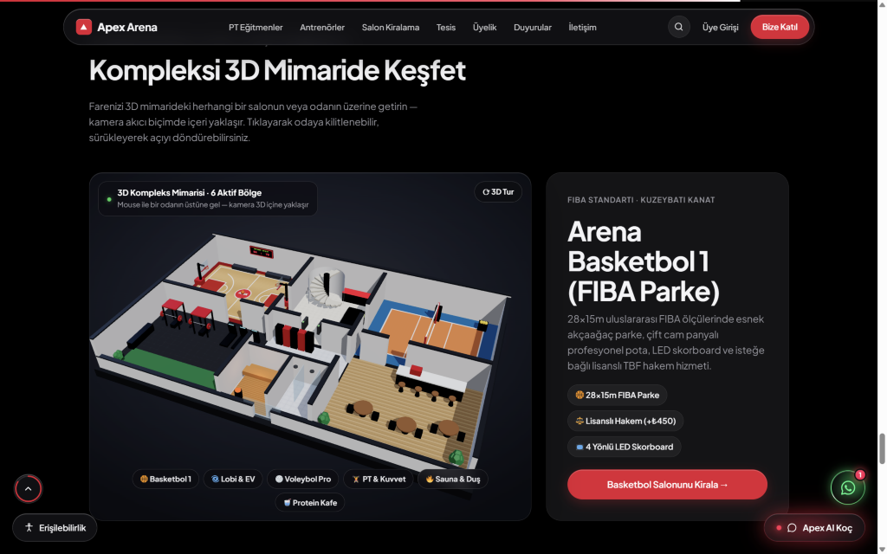
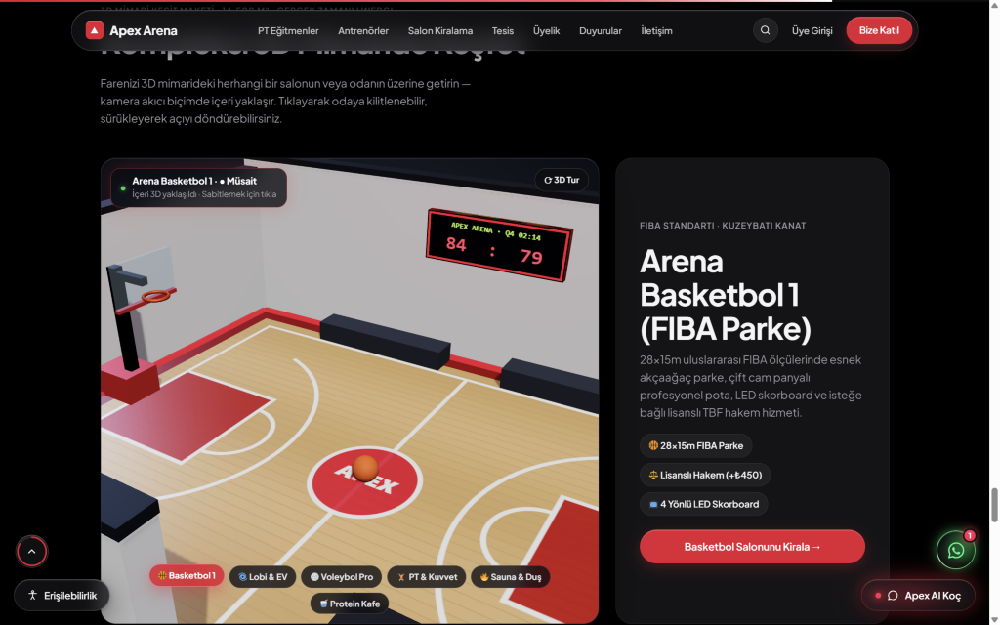
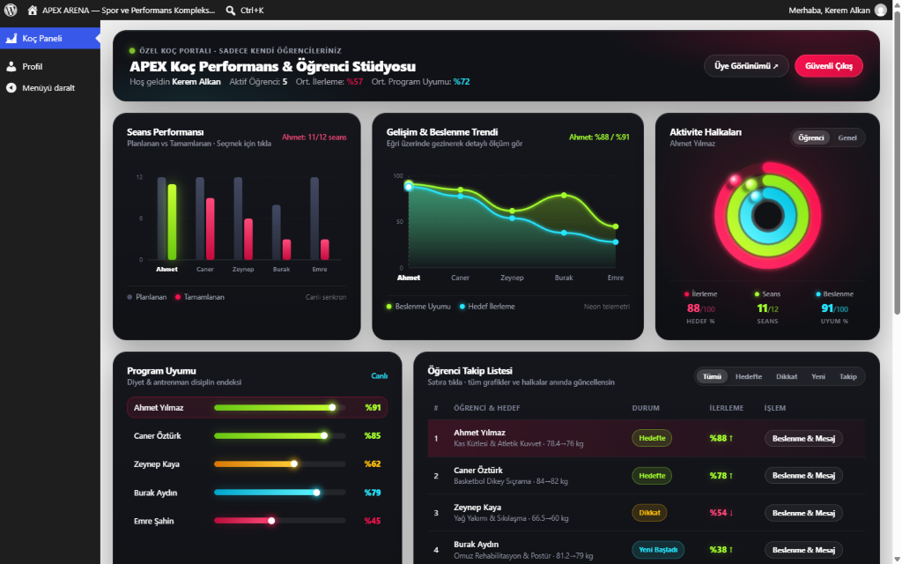
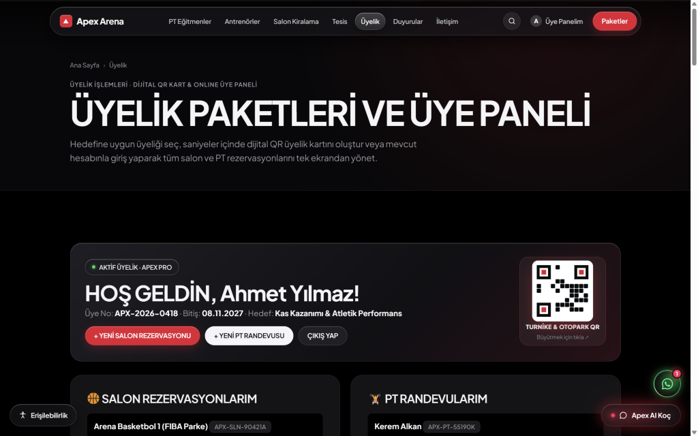
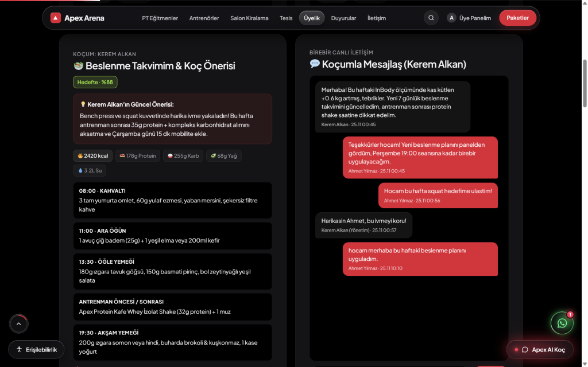
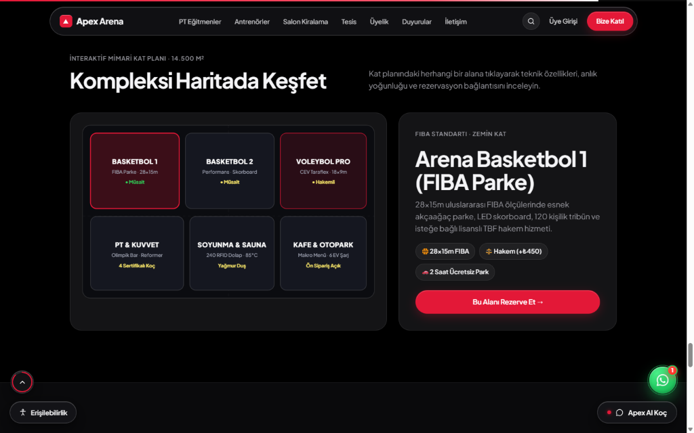
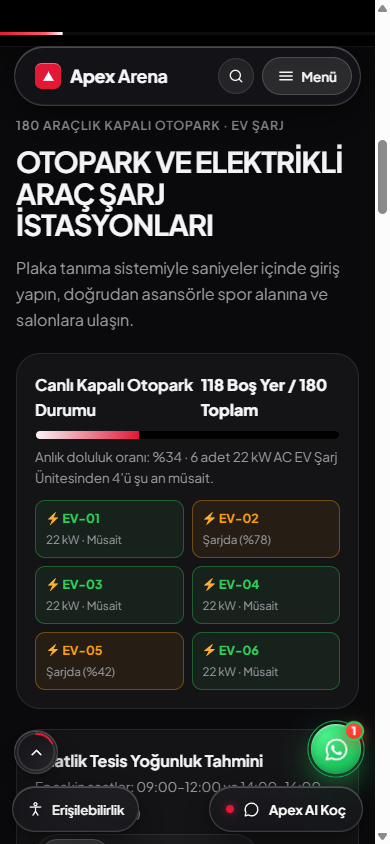
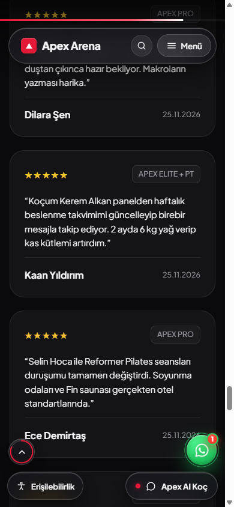

# APEX ARENA — Spor ve Performans Kompleksi (WordPress Özel Tema & Ekosistem)


> **Modern spor kompleksleri için sıfırdan geliştirilmiş, tam entegre özel WordPress teması ve çok rollü yönetim ekosistemi (`v2.3.0`).**  
> 60/120 FPS kaydırmayla oynayan mimari tur videosu, Three.js prosedürel 3D dambıl sahnesi, **Mouse Hover ile Oda İçine Yaklaşan 3D Mimari Kesit Spor Kompleksi Maketi**, **Tam Kapsamlı 5 Sekmeli Admin Site İçerik CMS Stüdyosu** (marka, renk, 7 menü etiketi, ana sayfa bölüm anahtarları, üyelik paket fiyatları, Protein Kafe menü CRUD, 7 iç sayfa hero metinleri), **Bütünleşik Mimari Editoryal İç Sayfa Tasarım Sistemi**, **Gmail SMTP Hoş Geldin & Otomatik Hatırlatma E-posta Motoru**, **Obsidian Neon Glow Operasyon Yönetim Paneli**, **7 Uzman Koçluk Apple Fitness Neon Glow Koç Performans Stüdyosu**, **Liquid Glass Shape Morph üst menü**, dönen zümrüt neon **WhatsApp Destek Hattı**, kırmızı glow **Gemini 2.5 Flash AI Spor Koçu**, büyütülebilir **Dijital QR Kart Pop-up**, makro hesaplı Protein Kafe ön sipariş sepeti, lisanslı hakem + `.ics` takvimli salon kiralama, **Excel/CSV Rapor Merkezi**, gerçek **Google Maps** ve **WCAG 2.2 AA/AAA** erişilebilirlik merkezini tek çatı altında sunar.

---

## Projenin Amacı

**APEX ARENA**, bir spor ve performans kompleksinin 3 farklı kullanıcı rolünü tek bir özel WordPress + MySQL mimarisi üzerinde kesintisiz ve tam responsive (`1440px` Masaüstü · `768px` Tablet · `390px` Mobil) biçimde yönetmek amacıyla geliştirilmiştir:
1. **Ziyaretçiler & Üyeler:** İnteraktif kat planıyla tesisi keşfeder, 3 soruluk akıllı quizle paketini bulur, salon/PT rezervasyonu yapar (`.ics` takvime ekler & WhatsApp maç daveti paylaşır), antrenman çıkışı Protein Kafe siparişi verir, tıklayınca büyüyen dijital QR kartını kullanır ve kendi koçunun hazırladığı canlı beslenme takvimiyle özel neon kaydırma çubuklu ekranda 1-1 mesajlaşır.
2. **7 Uzman Koç (`apex_coach` Özel Rolü):** Sadece kendi öğrencilerini görebildikleri izole neon grafiksel panelden seans/ilerleme/uyum grafiklerini ve Apple Fitness aktivite halkalarını takip eder, öğrenci durumuna göre 5 öğünlük beslenme takvimi + koç önerisi yayınlar ve birebir mesajlaşır.
3. **Yöneticiler (`root`):** Neon Glow Operasyon Paneli'nden canlı MySQL gelir dağılımını, 7 günlük talep & AI trendini, 3'lü tesis aktivite halkalarını ve canlı işlem akışını izler; tek tıkla Türkçe Excel uyumlu UTF-8 BOM CSV raporları indirir ve tüm 7 koçun (17 öğrenci) portföylerini denetler.

---

## v2.3.0 Yeni Modüller & Güncel Ekran Görüntüleri

### 0. Tam Kapsamlı Admin Site İçerik CMS Stüdyosu & Bütünleşik Editoryal İç Sayfalar (`inc/site-cms.php`, `page-*.php`)
- **Tek Panelden Tüm Siteyi Yönet (`WP Admin → APEX ARENA → Site İçerik CMS`):** 5 sekmeli Obsidian Neon yönetim arayüzüyle kod yazmadan site logosu/marka metinleri, canlı tema vurgu rengi (`--apex-crimson`), 7 üst menü etiketi, ana sayfa 10 bölümünün Göster/Gizle anahtarları ve tüm başlıkları, Classic/Pro/Elite üyelik paket fiyatları & kapsamları, Protein Kafe menüsü (ekle/düzenle/sil), 7 iç sayfa hero metinleri, WhatsApp hattı, Google Harita konumu ve Footer içerikleri anlık düzenlenebilir.
- **Tüm 7 Navigasyon Sayfasında Bütünleşik Mimari Editoryal Tasarım:** `PT Eğitmenler`, `Antrenörler`, `Salon Kiralama`, `Tesis`, `Üyelik`, `Duyurular` ve `İletişim` sayfaları kırmızı sol şeritli editoryal hero, `1px` ince ayırıcılı İsviçre tablo ızgaraları, tam çerçeve poster galerileri ve alt çizgili filtre sekmeleriyle bütünleşik mimari görünüme kavuşturuldu.

| Editoryal PT Eğitmenler (`/pt-egitmenler/`) | Editoryal Salon Kiralama (`/salon-kiralama/`) |
| :---: | :---: |
|  |  |

### 0A. İnteraktif 3D Mimari Kesit Spor Kompleksi (`assets/js/complex-3d.js`, `/#kat-plani`)
- **Tam İzometrik 3D Dollhouse Kesit Mimarisi:** Koyu kesit üst şeritli mimari duvarlar, merkez traverten lobide heykelsi **3D sarmal merdiven** + QR turnikeler + EV şarj bölmesi, **FIBA Basketbol 1** (akçaağaç parke, 3D cam panyalı potalar, canlı `84 : 79` LED skorboard), **CEV Voleybol Pro** (Taraflex zemin, 3D file), **PT & Kuvvet Stüdyosu** (çift olimpik squat rack, sprint turf, koşu bantları), **RFID Soyunma + Yağmur Duş + 85°C Sedir Fin Saunası** ve **Apex Protein Kafe & Lounge**.
- **Mouse Hover ile 3D Oda İçi Kamera Yaklaşması:** Fareyi herhangi bir odanın veya çipin üzerine getirdiğinizde kamera akıcı biçimde o odanın içine dalar; tıklayarak kilitleyebilir, sürükleyerek açıyı değiştirebilir veya `⟳ 3D Tur` modunu açabilirsiniz.

| 3D Mimari Kesit — İzometrik Genel Bakış (`/#kat-plani`) | Mouse Hover ile Basketbol 1 İçine 3D Kamera Yaklaşması |
| :---: | :---: |
|  |  |

### 0B. Gmail SMTP, Kayıt Hoş Geldin & Otomatik Hatırlatma Merkezi (`inc/mailer.php`)
- **Kayıt Sonrası Hoş Geldin & Dijital QR Kart E-postası:** Yeni üye kaydı (`/uyelik/`) tamamlandığında üyenin e-posta adresine APEX ARENA markalı, karanlık/crimson HTML şablonlu Hoş Geldin & QR Kart e-postası gönderilir.
- **Salon & PT Rezervasyon Onayları + 24 Saat Kala Otomatik Hatırlatma:** Salon ve PT randevularında anında onay e-postası iletilir; saatlik WP-Cron görevi yaklaşan randevulara 24 saat kala ve bitimine 7 gün kalan üyeliklere otomatik hatırlatma gönderir.
- **Obsidian Neon E-posta Merkezi (`WP Admin → APEX ARENA → E-posta & Hatırlatma`):** Gmail adresi + 16 haneli Google Uygulama Şifresi (App Password) ile sıfır eklentisiz canlı Gmail SMTP, tek tıkla Test Maili, anlık üye hatırlatması, CSV dışa aktarımı ve gönderilen tüm e-postaların canlı HTML `iframe` önizlemesi (`wp_apex_email_logs`).
- **Üye Paneli E-posta Tercihleri (`/uyelik/#eposta-hatirlatma`):** Üyeler hatırlatma tercihlerini yönetebilir, tek tıkla Hoş Geldin/QR veya Antrenman Hatırlatma mailini kendilerine gönderebilir ve son e-postalarını panel içinden görüntüleyebilir.

### 1. Obsidian Neon Glow Yönetim Operasyon Paneli (`inc/admin-panel.php`)
- **Canlı MySQL Telemetri & 4 Neon KPI Kartı:** Aktif salon rezervasyonları (hakemli maçlar dahil), PT randevuları, dijital QR üyelikler ve toplam işlem hacmi.
- **3 Dinamik Neon Grafik + Apple Fitness 3'lü Tesis Aktivite Halkası:**
  1. **Gelir Kanalı Performansı (Neon Bar Grafik):** Salon, PT, Üyelik ve Kafe için Hedef vs Gerçekleşen etkileşimli çubuklar.
  2. **Operasyon & AI Trendi (Çift Neon Eğri):** Son 7 günlük Talep & Gelir (neon yeşil) ve Tesis & AI (turkuaz) eğrileri.
  3. **Tesis Aktivite Halkaları (`Tesis` / `Gelir` Modlu):** Anlık Doluluk (%), Üye Memnuniyeti (`★ / 5.0`), Otopark Boş Alan (`118/180`) ve kanal ciro payları.
- **Parlayan Küre Uçlu Gelir Barları, Filtrelenebilir Canlı Operasyon Akışı & 5'li UTF-8 BOM Excel/CSV Rapor Merkezi.**


### 2. 7 Uzman Koçlu Grafiksel Öğrenci Yönetim Paneli (`inc/coach-portal.php`)
- **Tam Rol İzolasyonu (`apex_coach` · 7 Koç / 17 Öğrenci):** Koçlar `/wp-login.php` üzerinden giriş yaptığında doğrudan **Koç Grafik & Öğrenci Yönetim Paneli**'ne (`admin.php?page=apex-coach-portal`) yönlendirilir; her koç yalnızca kendi öğrencilerini yönetir. Yöneticiler üstteki **`Tüm Koçlar (7 Koç · 17 Öğrenci)`** menüsünden tüm koçlar arasında anlık geçiş yapabilir.
- **Apple Fitness 3'lü Neon Aktivite Halkaları & Etkileşimli Grafikler:** Seans Performansı (bar), Gelişim & Beslenme Trendi (çift neon eğri), Aktivite Halkaları (`Öğrenci / Genel`), Program Uyumu barları ve filtrelenebilir Öğrenci Takip Listesi.
- **Canlı Beslenme Takvimi & Birebir Mesajlaşma:** Koçun kaydettiği **5 öğünlük beslenme takvimi + makrolar**, **koç önerisi** ve **birebir mesajlar** öğrencinin `/uyelik/#uye-paneli` ekranına anında senkronize olur.



| Üye Paneli — Büyütülebilir Dijital QR Geçiş Kartı | Eşit Yükseklikli Beslenme Takvimi & Neon Scrollbar Koç Sohbeti |
| :---: | :---: |
|  |  |

### 2. İnteraktif Tesis Kat Planı, Canlı 5 Yıldızlı Yorumlar & Protein Kafe Ön Sipariş Sepeti
- **İnteraktif SVG Mimari Kat Planı (`/#kat-plani`):** 6 tıklanabilir kompleks bölgesi (*Basketbol 1, Basketbol 2, Voleybol Pro, PT & Kuvvet, Soyunma & Sauna, Kafe & Otopark*) ile anlık teknik özellik ve doğrudan rezervasyon bağlantısı.
- **Canlı 5 Yıldızlı Üye Değerlendirmeleri (`/#yorumlar`):** Yıldız seçici, dinamik ortalama puan güncellemesi ve MySQL'e kaydedilen üye yorum formu.
- **EV Şarj Monitörü, Saatlik Yoğunluk Grafiği & Kafe Sepeti (`/tesis-olanaklari/`):** 6 adet 22 kW EV şarj istasyonu anlık durumu, Hafta İçi / Cumartesi / Pazar saatlik yoğunluk tahmin barları ve anlık kalori/protein makro toplamlı **Antrenman Çıkışı Kafe Ön Sipariş Sepeti**.

| İnteraktif SVG Tesis Kat Planı (`/#kat-plani`) | Protein Kafe Makro Hesaplı Ön Sipariş Sepeti (`/tesis-olanaklari/#kafe`) |
| :---: | :---: |
|  |  |

### 3. `.ics` Takvim İndirme, WhatsApp Maç Daveti & Akıllı Paket Bulucu Quiz
- **Rezervasyon Onay Aksiyonları (`/salon-kiralama/`, `/pt-egitmenler/`, `/uyelik/`):** Her salon kiralaması ve PT randevusu sonrası tek tıkla **Google / Apple / Outlook `.ics` takvim dosyası indirme** ve otomatik metinli **💬 WhatsApp Maç Daveti Paylaşma** butonu.
- **3 Soruluk Akıllı Paket & PT Bulucu (`/uyelik/#paket-bulucu`):** Hedef, haftalık sıklık ve koçluk tercihine göre en uygun paketi ve antrenörü önerip tek tıkla kayıt formuna aktarır; altında detaylı **Paket Karşılaştırma Tablosu** yer alır.
- **Üye Haftalık Antrenman & Kalori Günlüğü (`/uyelik/#antrenman-takip`):** Üyeler günlük antrenman ve yaktıkları kaloriyi anlık kaydedip grafiksel olarak takip eder; kayıt koçun ilerleme paneline de yansır.

---

## Temel Mimari & Performans Mühendisliği (`v1.0.0` → `v2.0.0`)

- **60/120 FPS Scroll-Driven Mimari Tur Videosu (`assets/js/scroll-cinema.js`):** 240 adet HD WebP kare, off-main-thread GPU `createImageBitmap`, O(1) LRU önbellek, sıfır zorunlu layout ve mobilde %50 daha az veri tüketen adaptif kare adımı (`frameStep: 2`).
- **3D Cast-Iron Spin-Lock Dumbbell (`assets/js/motion-3d.js`):** Three.js prosedürel CAD dambıl, **`HAREKETİN YENİ MERKEZİ`** dev kinetik tipografisi, lazy WebGL yükleme ve görünüm dışı %0 CPU/GPU uyku modu.
- **Canlı Gemini 2.5 Flash AI Spor Koçu & Animasyonlu WhatsApp Destek Hattı:** Tüm sayfalarda çift sonar halkalı, parlama geçişli WhatsApp hattı + veritabanı destekli canlı Gemini 2.5 Flash AI asistanı.
- **İletişim + Gerçek Google Maps (`/iletisim/`):** İki sütunlu **Bize Yazın** + 5 kartlı **İletişim Bilgileri** (tek tıkla kopyalama + Liquid Glass toast + canlı **Şu An Açık/Kapalı** rozeti) + gerçek Ataşehir / İstanbul Google Maps haritası.
- **WCAG 2.2 AA/AAA Erişilebilirlik, KVKK & Yoast SEO (`tr_TR`):** Yazı boyutu, yüksek kontrast, aydınlık mod, *Lexend* disleksi fontu, sesli okuma, KVKK/çerez modalı, üst GPU scroll ilerleme çizgisi, SVG halkalı Yukarı Çık butonu ve `Ctrl+K` arama kısayolu.


---

## Demo, Koç & Yönetim Giriş Bilgileri

| Rol | Giriş Adresi | Kullanıcı Adı | Şifre | Açıklama |
| :--- | :--- | :--- | :--- | :--- |
| **WordPress Yönetici (Admin)** | `/wp-login.php` | `root` | `korkut2006` | Tam yönetim, Neon Glow Grafikler, CSV, Tüm 7 Koç |
| **Koç Portalı (Kerem Alkan)** | `/wp-login.php` | `koc_kerem` | `ApexKoc2026!` | Kendi 5 öğrencisi (Grafik + Beslenme + 1-1 Sohbet) |
| **Koç Portalı (Elif Karaca)** | `/wp-login.php` | `koc_elif` | `ApexKoc2026!` | Kendi 2 öğrencisi (Rol izolasyonlu) |
| **Diğer 5 Uzman Koç** | `/wp-login.php` | `koc_selin`, `koc_mert`, `koc_caner`, `koc_buse`, `koc_emirhan` | `ApexKoc2026!` | Her biri kendi 2 öğrencisi, beslenme planı ve grafikleriyle |
| **Demo Üye (QR & Koç Takibi)** | `/uyelik/#giris` | `uye_demo` | `ApexUye2026!` | Büyüyen QR Kart + Koç Beslenme Takvimi + 1-1 Mesaj + Antrenman Günlüğü |

---

## Kurulum ve Çalıştırma Rehberi (XAMPP)

### Yöntem A — Tam Veritabanı ile Birebir Kurulum (Önerilen)
1. [XAMPP](https://www.apachefriends.org/) üzerinden **Apache** ve **MySQL (MariaDB)** servislerini başlatın.
2. Temiz bir WordPress kurulumunu `C:\xampp\htdocs\spor_kompleksi\wordpress\` dizinine yerleştirin.
3. Bu repodaki `apex-arena/` klasörünü `wordpress/wp-content/themes/apex-arena/` içine kopyalayın (veya `teslim_belgeleri/apex-arena-envato-theme.zip` dosyasını WP Admin → **Görünüm → Temalar → Yeni Ekle → Tema Yükle** üzerinden yükleyin).
4. `http://localhost/phpmyadmin` adresinde **`spor_kompleksi_wp`** (`utf8mb4_unicode_ci`) veritabanını oluşturun ve `teslim_belgeleri/spor_kompleksi_wp.sql` dosyasını içe aktarın.
5. Tarayıcıdan `http://localhost/spor_kompleksi/wordpress/` adresini açın.

### Yöntem B — Sadece Tema Kurulumu
1. `teslim_belgeleri/apex-arena-envato-theme.zip` paketini WordPress panelinden yükleyip **Etkinleştir** butonuna tıklayın (11 özel MySQL tablosu, `apex_coach` rolü, demo koç/öğrenci/beslenme/yorum/kafe verileri ve 4 Custom Post Type otomatik oluşturulur).
2. İsteğe bağlı olarak **Araçlar → İçe Aktar → WordPress** üzerinden `teslim_belgeleri/apex-arena-wordpress-export.xml` dosyasını yükleyebilirsiniz.
3. Canlı Gemini 2.5 Flash AI sohbeti için **WP Admin → APEX ARENA → AI & Ayarlar** ekranına kendi Google AI Studio Gemini API anahtarınızı girebilirsiniz *(güvenlik nedeniyle paylaşılan SQL yedeğindeki API anahtarı maskelenmiştir; anahtar girilmezse yerel Hibrit WP Veritabanı Motoru otomatik çalışır)*.

---

## WordPress REST API Uç Noktaları (`/wp-json/apex/v1/`)

| Metod | Uç Nokta | Açıklama |
| :--- | :--- | :--- |
| `GET` | `/availability?type=court\|trainer&id=X&date=YYYY-MM-DD` | Salon veya antrenör canlı saat müsaitliği |
| `POST` | `/book-court` | Basketbol / Voleybol salonu + lisanslı hakem rezervasyonu |
| `POST` | `/book-pt` | Online PT antrenman randevu kaydı |
| `POST` | `/membership/register` & `/membership/login` | Dijital üyelik kaydı, oturum açma ve QR üretimi |
| `POST` | `/booking/cancel` | Üye panelinden aktif rezervasyon iptali |
| `POST` | `/contact` | İletişim formu veritabanı kaydı |
| `POST` | `/chat` | Gemini 2.5 Flash + WP Hibrit AI Spor Koçu |
| `GET` / `POST` | `/reviews` | Canlı 5 yıldızlı üye değerlendirmeleri |
| `POST` | `/cafe-order` | Apex Protein Kafe antrenman çıkışı ön siparişi |
| `POST` | `/workout-log` | Üye haftalık antrenman & kalori günlüğü kaydı |
| `POST` | `/member/message` | Üyeden koçuna 1-1 canlı mesaj gönderimi |
| `POST` | `/coach/save-student` | Koçun kendi öğrencisinin durum, öneri & beslenme takvimini kaydetmesi |
| `POST` | `/coach/message` | Koçtan kendi öğrencisine 1-1 canlı mesaj gönderimi |
| `POST` | `/member/mail-action` | Üye hatırlatma tercihi ve anlık Hoş Geldin / Hatırlatma e-posta gönderimi |
| `GET` | `/member/emails` | Üyenin gönderilmiş/önizlenebilir e-posta geçmişi |

---

## Depo ve Teslim Dosyaları Yapısı

```text
spor_kompleksi/
├── README.md                              # Proje dokümantasyonu ve kullanım rehberi (v2.0.0)
├── CHANGELOG.md                           # Sürüm geçmişi (v1.0.0 → v2.0.0)
├── LICENSE                                # GNU GPL v2+ Lisansı
├── apex-arena/                            # WordPress Özel Tema Kaynak Kodları (v2.0.0)
│   ├── style.css, functions.php, theme.json
│   ├── front-page.php, header.php, footer.php
│   ├── page-*.php (pt-egitmenler, antrenorler, salon-kiralama, tesis-olanaklari, uyelik, duyurular, iletisim, sss)
│   ├── inc/ (database, post-types, helpers, ai-chatbot, api-endpoints, admin-panel, coach-portal, admin-login-theme, customizer)
│   ├── template-parts/ (accessibility-widget, chatbot-widget, cookie-banner)
│   └── assets/ (css/, js/, images/, video-frames/)
└── teslim_belgeleri/                      # Akademik & Kurumsal Teslim Paketi
    ├── apex-arena-envato-theme.zip        # Kuruluma hazır WordPress özel tema ZIP paketi (v2.0.0)
    ├── spor_kompleksi_wp.sql              # Güncel, 11 özel tablolu & API anahtarı temizlenmiş MySQL yedeği
    ├── apex-arena-wordpress-export.xml    # WordPress WXR 1.2 içerik dışa aktarımı
    ├── Sistem_Kullanim_Kitapcigi.md       # Sistem kullanım kitapçığı (Markdown)
    ├── Sistem_Kullanim_Kitapcigi.html     # Yazdırılabilir kullanım kitapçığı (HTML/PDF)
    └── ekran_goruntuleri/                 # Masaüstü (1440px), Koç Portalı & Mobil (390px) ekran görüntüleri
```

---

## Responsive Doğrulama (Masaüstü · Tablet · Mobil)

Tüm sayfalar **Masaüstü (`1440×900`)**, **Tablet (`768×1024`)** ve **Mobil (`390×844`)** kırılımlarında `0px` yatay taşma ve `0` yerel JS/PHP hatasıyla test edilmiştir.

| Mobil EV Şarj & Otopark (`390×844`) | Mobil Canlı Üye Yorumları (`390×844`) |
| :---: | :---: |
|  |  |

---

**Geliştirici:** İbrahim Korkut · **Sürüm:** `v2.2.0` · **Lisans:** GPL v2 or later
