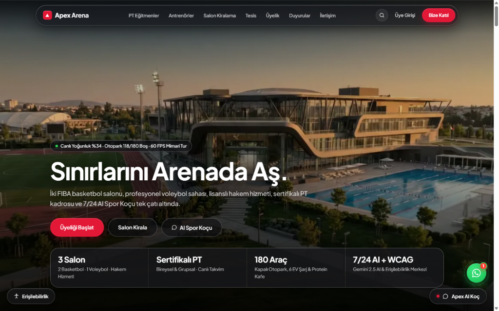
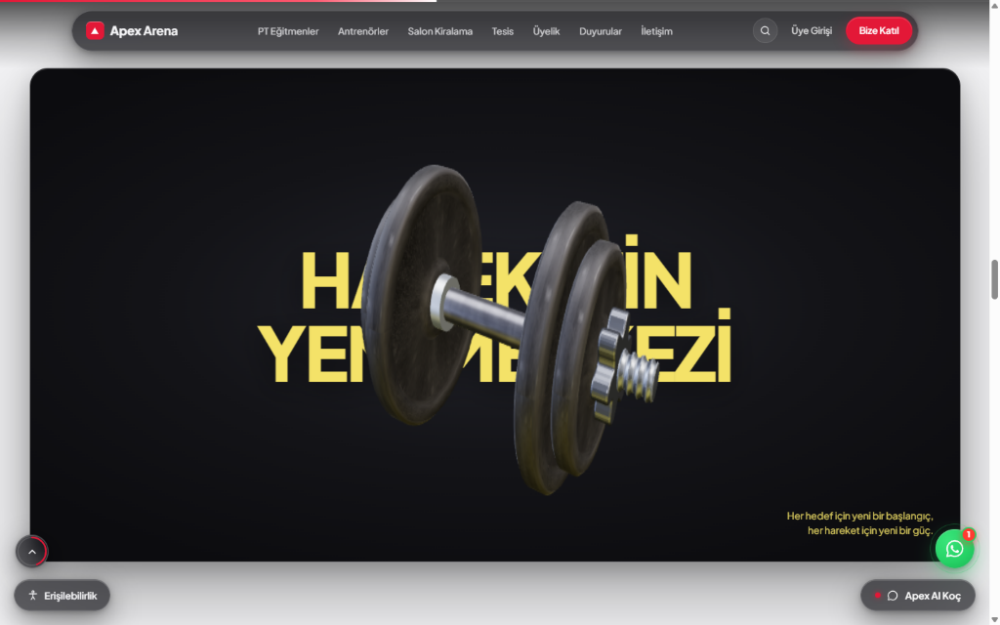
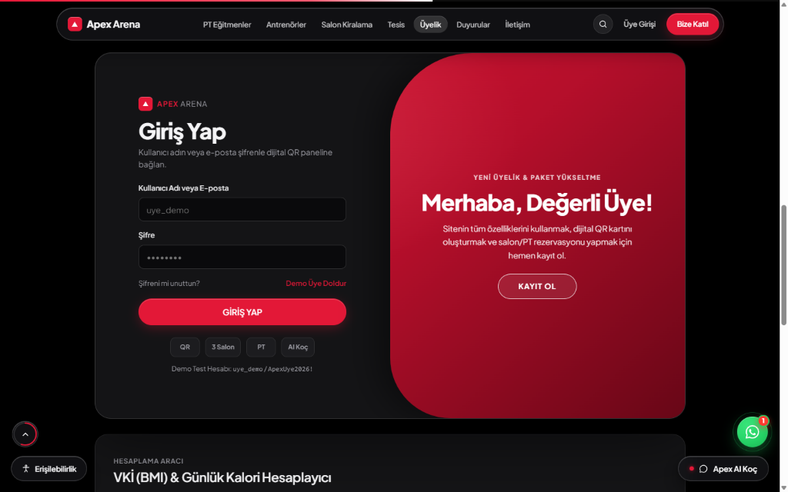
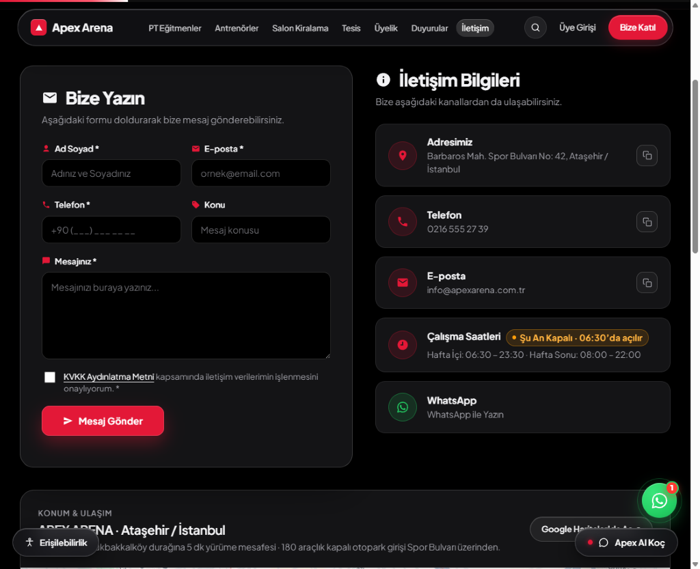
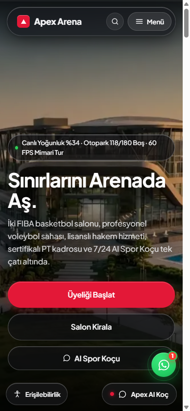
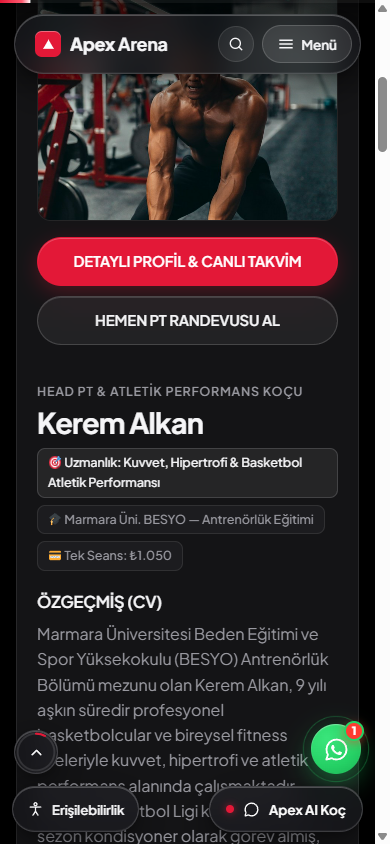

# APEX ARENA — Spor ve Performans Kompleksi (WordPress Özel Tema & Sistem)



> **Modern spor kompleksleri için sıfırdan geliştirilmiş, Envato / ThemeForest standartlarında özel WordPress teması (`v1.7.1`).**  
> 60/120 FPS kaydırmayla oynayan mimari tur videosu, Three.js prosedürel 3D dambıl sahnesi, canlı **Gemini 2.5 Flash AI Spor Koçu**, lisanslı hakem opsiyonlu salon kiralama, sertifikalı PT/antrenör takvimi, dijital QR üyelik kartı, gerçek **Google Maps** entegrasyonu, **WhatsApp Destek Hattı**, **Yoast SEO** ve **WCAG 2.2 AA/AAA** erişilebilirlik merkezini tek çatı altında sunar.

---

## Projenin Amacı

**APEX ARENA**, bir spor ve performans kompleksinin hem **ziyaretçi/üye deneyimini** (salon rezervasyonu, PT randevusu, dijital QR üyelik, tesis inceleme, anlık AI danışmanlık ve WhatsApp desteği) hem de **işletme yönetimini** (WordPress Admin panelinden rezervasyon/randevu onaylama, doluluk ve fiyat ayarlama, dinamik AI sağlayıcı seçimi) tek bir özel WordPress teması üzerinde kesintisiz, hızlı ve tam responsive (Masaüstü `1440px`, Tablet `768px`, Mobil `390px`) biçimde yönetmek amacıyla geliştirilmiştir.

---

## Öne Çıkan Özellikler ve Modüller

### 1. Sinematik Ana Sayfa & Yüksek Performans Mühendisliği (`v1.7.1`)
- **60/120 FPS Scroll-Driven Mimari Tur Videosu (`assets/js/scroll-cinema.js`):** 240 adet HD WebP kareden oluşan 20 saniyelik kompleks turu, kullanıcı sayfayı kaydırdıkça kare kare ilerler. Off-main-thread GPU `createImageBitmap`, O(1) LRU önbellek, sıfır zorunlu layout (`forcedLayouts: 0`), kaynak çözünürlüğüne uyumlu canvas boyutlandırma ve mobil cihazlarda %50 daha az veri tüketen adaptif kare adımı (`frameStep: 2`) ile takılmadan çalışır.
- **3D Perspektif Monolit & Cast-Iron Spin-Lock 3D Dumbbell (`assets/js/motion-3d.js`):** Three.js ile prosedürel CAD olarak modellenen 3D dökme demir dambıl, **`HAREKETİN YENİ MERKEZİ`** dev kinetik tipografisinin önünde kaydırma ve imleç hareketine tepki verir. Lazy WebGL başlatma (`0 ms` açılış engellemesi), 32-bit tamsayı doku hash'i ve görünüm dışındayken %0 CPU/GPU tüketen otomatik uyku modu içerir.



### 2. Spor Kompleksi İş Modülleri
- **PT Eğitmenler (`/pt-egitmenler/`):** Bireysel & Grupsal PT kategori filtreleri, 6 farklı seans paketi ve şeffaf ücretler, haftalık ders programı tablosu, antrenör seçimi ve canlı MySQL online randevu formu.
- **Antrenörler & Canlı Takvim (`/antrenorler/`, `/antrenor/{slug}/`):** 4 uzman antrenör (Kerem Alkan, Selin Yılmaz, Mert Demir, Elif Karaca), özgeçmiş, tıklanabilir **Resmi Sertifika Doğrulama Modalı** ve mobil yatay kaydırmalı haftalık müsaitlik tablosu.
- **Salon ve Kiralama (`/salon-kiralama/`):** 2 adet FIBA Basketbol + 1 adet CEV Voleybol salonu, fotoğraf Lightbox galerisi, **Lisanslı Hakem Ayarlama Hizmeti (+₺450)** ve anlık çakışma korumalı saat rezervasyonu.
- **Tesis Olanakları (`/tesis-olanaklari/`):** 240 RFID akıllı dolaplı soyunma odası/duş/sauna, canlı doluluk göstergeli 180 araçlık kapalı otopark & 6 EV şarj istasyonu, kategori filtreli **Apex Protein Kafe Menüsü**.
- **Üyelik İşlemleri & QR Kart (`/uyelik/`):** Aylık/Yıllık (%20 indirimli) fiyat geçişi, çift yönlü kavisli kayar **Üye Girişi / Kayıt Ol** kartı, **Dijital Turnike/Otopark QR Kartı**, rezervasyon iptali ve anlık **VKİ & Günlük Kalori Hesaplayıcı**.



### 3. İletişim, Gerçek Google Maps, WhatsApp Hattı & Yapay Zeka
- **Yenilenen İletişim Sayfası (`/iletisim/`):** Sol sütunda ikonlu **Bize Yazın** formu, sağ sütunda 5 kartlı **İletişim Bilgileri** (tek tıkla panoya kopyalama + Apple Liquid Glass toast bildirimi, gerçek zamanlı **"Şu An Açık / Kapalı"** tesis durum rozeti) ve alt kısımda **gerçek etkileşimli Ataşehir / İstanbul Google Maps** haritası.
- **Yüzen WhatsApp Destek Hattı:** Tüm sayfalarda **Apex AI Koç** butonunun hemen üstünde, yeşil nabız halkalı ve bildirim rozetli tek tıkla WhatsApp (`wa.me`) destek butonu.
- **Canlı Gemini 2.5 Flash AI Spor Koçu:** Doğal Türkçe sohbet edebilen, aynı zamanda canlı WordPress veritabanından salon müsaitliği, PT ücretleri, üyelikler ve VKİ analizi sunan hibrit yapay zeka asistanı.
- **Özel Koyu Yönetim Paneli Girişi (`/wp-login.php`):** Kurumsal `APEX ARENA` koyu temalı yönetici giriş ekranı ve şifre görünürlük geçişi.



### 4. Erişilebilirlik (WCAG 2.2 AA/AAA), SEO & Mikro-Etkileşimler
- **WCAG 2.2 AA/AAA Erişilebilirlik Merkezi:** Yazı boyutu (%85–%145), Yüksek Kontrast AAA, Aydınlık Mod, Disleksi Dostu *Lexend* fontu, Link Vurgula, Animasyon Durdur, Gri Tonlama, Okuma Kılavuzu, Büyük İmleç ve Türkçe Sesli Okuma.
- **SEO & KVKK:** Resmi **Yoast SEO (`tr_TR`)** yapılandırması, Schema.org `SportsActivityLocation` JSON-LD, XML site haritası ve interaktif KVKK / Çerez Tercih Yönetimi.
- **Küçük Ama Etkili UX Dokunuşları (`v1.7.1`):**
  - Sayfa üstü GPU destekli **okuma/scroll ilerleme çizgisi** (`2.5px`)
  - Sol alt köşede canlı SVG ilerleme halkalı **Akıllı Yukarı Çık** butonu
  - **`Ctrl+K` / `/`** klavye kısayolu ile anlık site içi arama (`ESC` ile kapatma)
  - Tek tıkla kopyalama + **Liquid Glass Toast** bildirim sistemi
  - Masaüstü kartlarda sıfır-layout **imleç ışığı (pointer spotlight)** ve GPU scroll-reveal

---

## Kurulum ve Çalıştırma Rehberi

### Yöntem A — Tam Veritabanı ile Birebir Kurulum (XAMPP — Önerilen)
1. [XAMPP](https://www.apachefriends.org/) üzerinden **Apache** ve **MySQL (MariaDB)** servislerini başlatın.
2. Temiz bir WordPress kurulumunu `C:\xampp\htdocs\spor_kompleksi\wordpress\` dizinine yerleştirin.
3. Bu repodaki `apex-arena/` klasörünü `wordpress/wp-content/themes/apex-arena/` içine kopyalayın (veya `teslim_belgeleri/apex-arena-envato-theme.zip` dosyasını WP Admin → **Görünüm → Temalar → Yeni Ekle → Tema Yükle** üzerinden yükleyin).
4. `http://localhost/phpmyadmin` adresinde **`spor_kompleksi_wp`** (`utf8mb4_unicode_ci`) adlı veritabanını oluşturun ve `teslim_belgeleri/spor_kompleksi_wp.sql` dosyasını içe aktarın.
5. Tarayıcıdan `http://localhost/spor_kompleksi/wordpress/` adresini açın.

### Yöntem B — Sadece Tema Kurulumu
1. `teslim_belgeleri/apex-arena-envato-theme.zip` paketini WordPress panelinden yükleyip **Etkinleştir** butonuna tıklayın (5 özel MySQL tablosu ve 4 Custom Post Type otomatik oluşturulur).
2. İsteğe bağlı olarak **Araçlar → İçe Aktar → WordPress** üzerinden `teslim_belgeleri/apex-arena-wordpress-export.xml` dosyasını yükleyerek tüm demo sayfaları ve antrenör/salon içeriklerini saniyeler içinde ekleyin.
3. Canlı Gemini 2.5 Flash AI sohbeti için **WP Admin → APEX ARENA → AI & Ayarlar** ekranına kendi Google AI Studio Gemini API anahtarınızı girebilirsiniz *(güvenlik nedeniyle paylaşılan SQL yedeğindeki API anahtarı maskelenmiştir; anahtar girilmezse yerel Hibrit WP Veritabanı Motoru otomatik çalışır)*.

---

## Demo & Yönetim Giriş Bilgileri

| Rol | Giriş Adresi | Kullanıcı Adı | Şifre |
| :--- | :--- | :--- | :--- |
| **WordPress Yönetici (Admin)** | `/wp-login.php` | `root` | `korkut2006` |
| **Demo Üye (QR Kart & Panel)** | `/uyelik/#giris` | `uye_demo` | `ApexUye2026!` |

---

## WordPress REST API Uç Noktaları (`/wp-json/apex/v1/`)

| Metod | Uç Nokta | Açıklama |
| :--- | :--- | :--- |
| `GET` | `/availability?type=court\|trainer&id=X&date=YYYY-MM-DD` | Salon veya antrenör canlı saat müsaitliği |
| `POST` | `/book-court` | Basketbol / Voleybol salonu + lisanslı hakem rezervasyonu |
| `POST` | `/book-pt` | Online PT antrenman randevu kaydı |
| `POST` | `/membership/register` & `/membership/login` | Dijital üyelik kaydı, oturum açma ve QR üretimi |
| `POST` | `/booking/cancel` | Üye panelinden aktif rezervasyon iptali |
| `POST` | `/contact` | İletişim formu veritabanı kaydı |
| `POST` | `/chat` | Gemini 2.5 Flash + WP Hibrit AI Spor Koçu |

---

## Depo ve Teslim Dosyaları Yapısı

```text
spor_kompleksi/
├── README.md                              # Proje dokümantasyonu ve kullanım rehberi
├── CHANGELOG.md                           # Sürüm geçmişi (v1.0.0 → v1.7.1)
├── LICENSE                                # GNU GPL v2+ Lisansı
├── apex-arena/                            # WordPress Özel Tema Kaynak Kodları (v1.7.1)
│   ├── style.css, functions.php, theme.json
│   ├── front-page.php, header.php, footer.php
│   ├── page-*.php (pt-egitmenler, antrenorler, salon-kiralama, tesis-olanaklari, uyelik, duyurular, iletisim, sss)
│   ├── inc/ (database, post-types, helpers, ai-chatbot, api-endpoints, admin-panel, admin-login-theme, customizer)
│   ├── template-parts/ (accessibility-widget, chatbot-widget, cookie-banner)
│   └── assets/ (css/, js/, images/, video-frames/)
└── teslim_belgeleri/                      # Akademik & Kurumsal Teslim Paketi
    ├── apex-arena-envato-theme.zip        # Kuruluma hazır WordPress özel tema ZIP paketi (v1.7.1)
    ├── spor_kompleksi_wp.sql              # Güncel, API anahtarı temizlenmiş MySQL yedeği
    ├── apex-arena-wordpress-export.xml    # WordPress WXR 1.2 içerik dışa aktarımı
    ├── Sistem_Kullanim_Kitapcigi.md       # Sistem kullanım kitapçığı (Markdown)
    ├── Sistem_Kullanim_Kitapcigi.html     # Yazdırılabilir kullanım kitapçığı (HTML/PDF)
    └── ekran_goruntuleri/                 # Masaüstü (1440px) & Mobil (390px) güncel ekran görüntüleri
```

---

## Responsive Doğrulama (Masaüstü · Tablet · Mobil)

Tüm sayfalar (`10/10` rota) **Masaüstü (`1440×900`)**, **Tablet (`768×1024`)** ve **Mobil (`390×844`)** kırılımlarında `0px` yatay taşma ve `0` yerel JS konsol hatasıyla test edilmiştir.

| Mobil Ana Sayfa (`390×844`) | Mobil Antrenörler & Takvim (`390×844`) |
| :---: | :---: |
|  |  |

---

**Geliştirici:** İbrahim Korkut · **Sürüm:** `v1.7.1` · **Lisans:** GPL v2 or later
