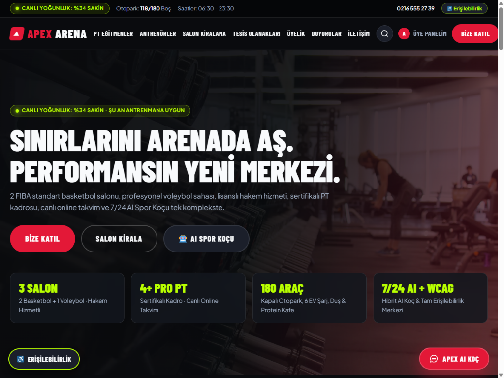

# APEX ARENA — Spor Kompleksi Özel WordPress Teması



> **Envato / ThemeForest standartlarında**, sıfır eklenti bağımlılıklı, tam responsive (1440px → 390px), WCAG 2.2 AA erişilebilirlik merkezli ve Hibrit AI Spor Koçlu modern spor kompleksi WordPress teması.

- **Figma Tasarım Sistemi & Ekranlar:** [APEX ARENA Figma Dosyası](https://www.figma.com/design/hlmHQON7ZrmxI3T3yQj4qC)
- **WordPress Uyumluluğu:** WordPress 6.4 – 6.9+ · PHP 8.0+ · `theme.json` v3
- **Lisans:** GNU General Public License v2 or later

## Öne Çıkan Özellikler

- **PT Eğitmenler (`/pt-egitmenler/`):** Bireysel & Grupsal antrenmanlar, 6 PT paketi & seans ücretleri, eğitim kapsamı, haftalık program tablosu, antrenör seçimi ve canlı MySQL randevu sistemi.
- **Antrenörler (`/antrenorler/`):** Fotoğraf, uzmanlık alanı, özgeçmiş, tıklanabilir Sertifika Doğrulama Modalı ve haftalık/canlı online müsaitlik takvimi.
- **Salon ve Kiralama (`/salon-kiralama/`):** 2 Adet FIBA Basketbol Salonu + 1 Adet CEV Voleybol Salonu, Lightbox fotoğraf galerisi, **Lisanslı Hakem Ayarlama Hizmeti (+₺450)** ve çakışma korumalı canlı saat seçimi.
- **Tesis Olanakları (`/tesis-olanaklari/`):** 240 RFID akıllı dolaplı Soyunma Odası & Duş & Sauna, canlı doluluk göstergeli 180 araçlık Kapalı Otopark + 6 EV Şarj, makro hesaplı Apex Protein Kafe Menüsü.
- **Üyelik İşlemleri (`/uyelik/`):** Aylık/Yıllık paket karşılaştırması, online kayıt/giriş, **Dijital QR Üyelik Kartı**, üye rezervasyon yönetimi ve VKİ/Kalori Hesaplayıcı.
- **WCAG 2.2 AA/AAA Erişilebilirlik Merkezi:** Yazı boyutu, yüksek kontrast, aydınlık okuma modu, disleksi dostu Lexend fontu, bağlantı vurgulama, animasyon durdurma, gri tonlama, okuma kılavuzu, büyük imleç ve Türkçe sesli okuma.
- **Hibrit AI Spor Koçu (Chatbot):** WP Admin panelinden Google Gemini veya OpenAI API anahtarı bağlandığında gerçek LLM + RAG; anahtarsız/offline ortamda canlı WP veritabanını sorgulayan Türkçe akıllı asistan.
- **KVKK & Çerez Yönetimi:** İnteraktif Çerez Tercih Banner & Modalı + tam Türkçe yasal metin sayfaları.

## Kurulum

1. Tema klasörünü `wp-content/themes/apex-arena/` dizinine kopyalayın (veya ZIP paketini **Görünüm → Temalar → Yeni Ekle** üzerinden yükleyin).
2. Temayı etkinleştirin (5 özel MySQL tablosu ve 4 Custom Post Type otomatik oluşturulur).
3. İsteğe bağlı olarak **APEX ARENA → AI & Ayarlar** menüsünden Google Gemini / OpenAI API anahtarınızı ve tesis bilgilerinizi güncelleyin.

## Dizin Yapısı

```text
apex-arena/
├── style.css
├── theme.json
├── functions.php
├── screenshot.png
├── readme.txt
├── languages/apex-arena.pot
├── assets/
│   ├── css/ (main.css, accessibility.css)
│   ├── js/  (main.js, booking.js, accessibility.js, chatbot.js)
│   └── images/ (11 adet yerel optimize spor fotoğrafı)
├── inc/
│   ├── database.php
│   ├── post-types.php
│   ├── helpers.php
│   ├── ai-chatbot.php
│   ├── api-endpoints.php
│   ├── admin-panel.php
│   └── customizer.php
├── template-parts/
│   ├── accessibility-widget.php
│   ├── chatbot-widget.php
│   └── cookie-banner.php
└── *.php (front-page, page-pt-egitmenler, page-antrenorler, page-salon-kiralama, page-tesis-olanaklari, page-uyelik, page-duyurular, page-iletisim, page-sss, single-apex_trainer, vb.)
```
