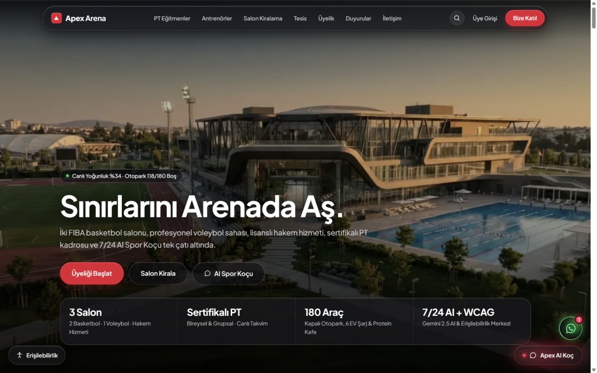
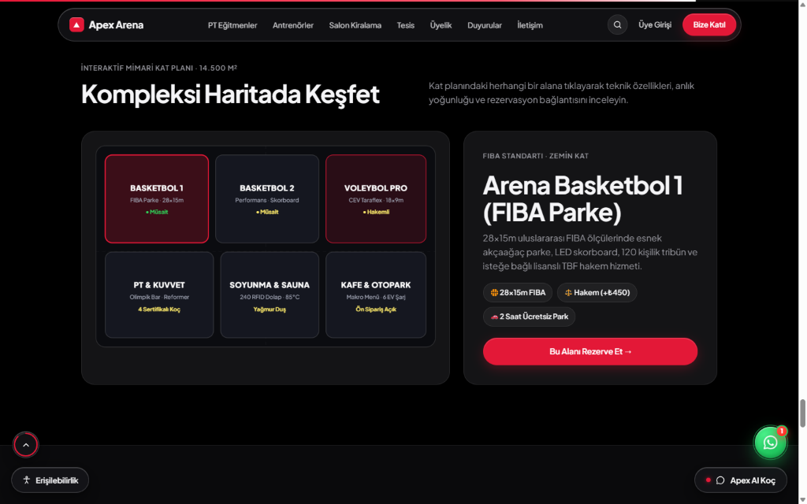
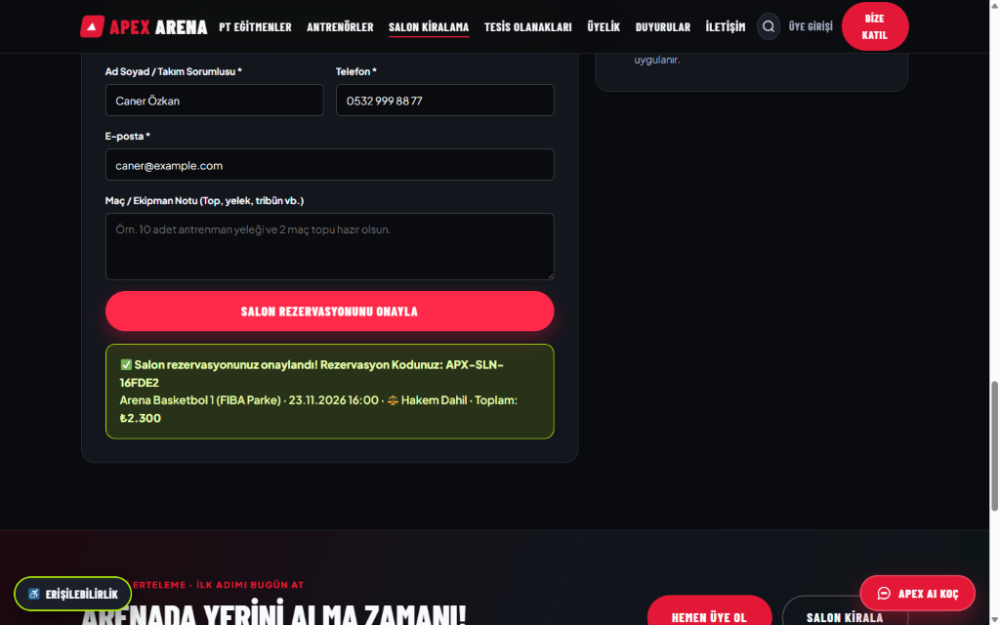
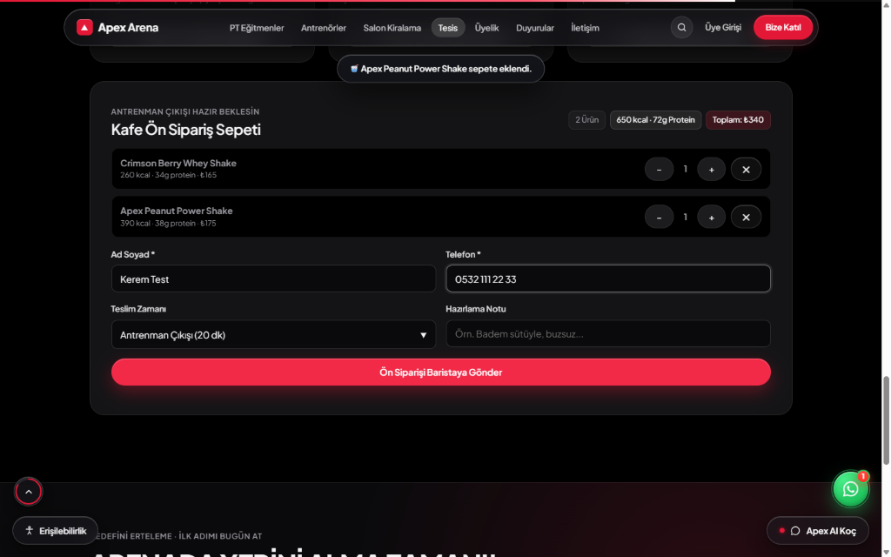
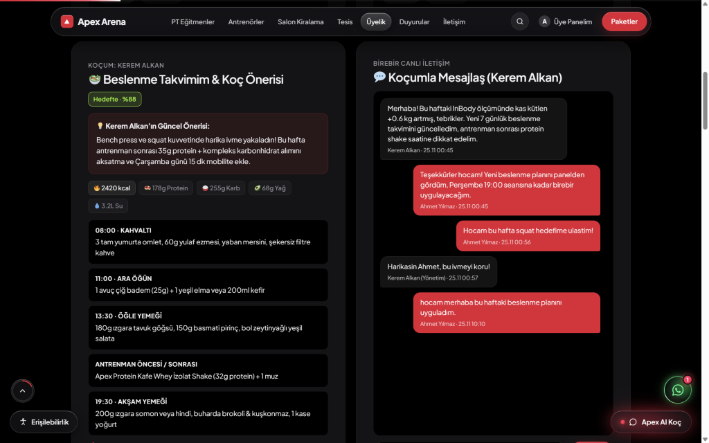
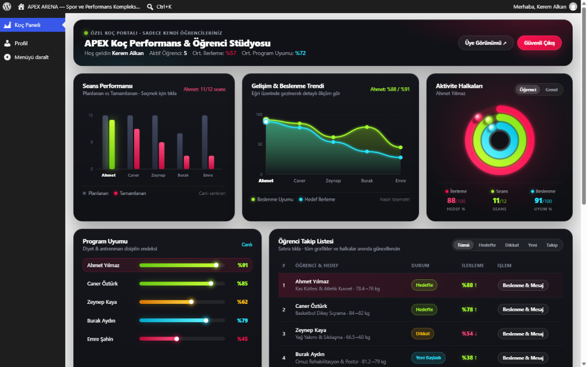
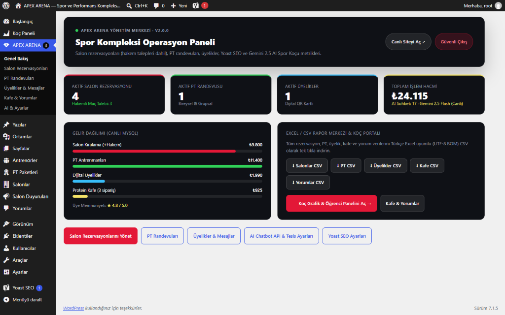
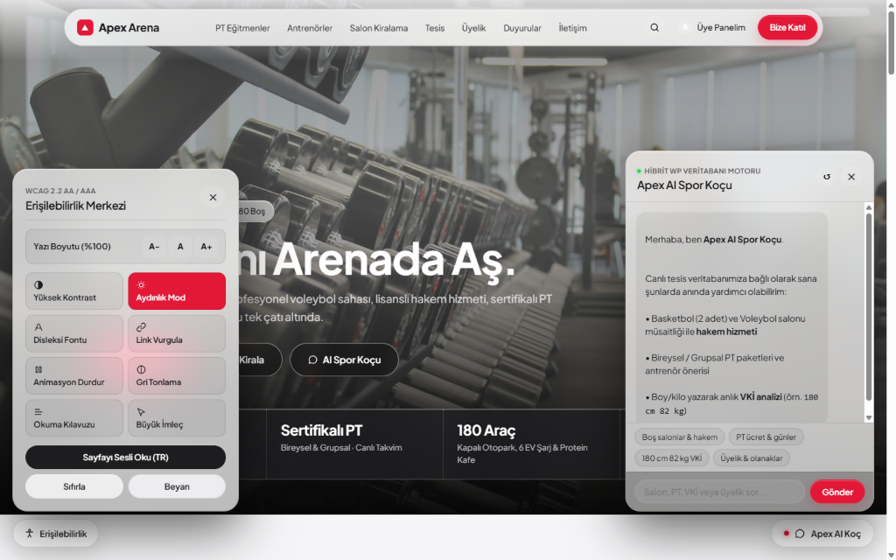

# APEX ARENA — Spor ve Performans Kompleksi
## Sistem Kullanım Kitapçığı & Kurulum Dokümantasyonu (`v2.0.2`)

| Proje Bilgisi | Değer |
| :--- | :--- |
| **Proje Adı** | APEX ARENA — Spor ve Performans Kompleksi (Özel WordPress Teması & Ekosistemi) |
| **Geliştirici (Ad-Soyad)** | İbrahim Korkut |
| **Tema Sürümü** | `v2.0.2` (WordPress Özel Tema — Envato / ThemeForest Uyumlu) |
| **Canlı Yerel Adres** | `http://localhost/spor_kompleksi/wordpress/` |
| **GitHub Deposu** | https://github.com/ibrahimkorkut/spor_kompleksi |
| **Envato Market / Tema Paketi** | `teslim_belgeleri/apex-arena-envato-theme.zip` (`https://themeforest.net/`) |
| **Veritabanı Yedeği (SQL)** | `teslim_belgeleri/spor_kompleksi_wp.sql` *(API anahtarı güvenlik için maskelenmiştir)* |
| **WordPress Dışa Aktarımı (WXR 1.2)** | `teslim_belgeleri/apex-arena-wordpress-export.xml` (`41` içerik öğesi) |
| **Figma Tasarım Sistemi** | https://www.figma.com/design/hlmHQON7ZrmxI3T3yQj4qC |

---

## 1. Değerlendirme Kriterleri Eşleştirme Tablosu (100 / 100 Puan)

| # | Değerlendirme Kriteri | Puan | Projede Karşılığı (Dosya / Canlı URL) | Durum |
| :---: | :--- | :---: | :--- | :---: |
| 1 | **WordPress Klasörü** | 2,5 | `C:\xampp\htdocs\spor_kompleksi\wordpress\` + GitHub `apex-arena/` + `apex-arena-envato-theme.zip` | ✅ Tamam |
| 2 | **Database Dosyası** | 2,5 | `teslim_belgeleri/spor_kompleksi_wp.sql` (11 özel tablo + tüm WP verileri, UTF-8MB4) | ✅ Tamam |
| 3 | **WordPress Dışarı Aktar Dosyası** | 5 | `teslim_belgeleri/apex-arena-wordpress-export.xml` (Resmi WXR 1.2 · 14 sayfa, 4 antrenör, 6 PT paketi, 3 salon, 4 duyuru) | ✅ Tamam |
| 4 | **Sistem Kullanım Kitapçığı** | 15 | `teslim_belgeleri/Sistem_Kullanim_Kitapcigi.md` + yazdırılabilir görselli `Sistem_Kullanim_Kitapcigi.html` | ✅ Tamam |
| 5 | **PT Eğitmenler — Bireysel Antrenman** | 5 | `/pt-egitmenler/#bireysel` — Kategori filtresi, birebir PT kapsamı ve paketleri | ✅ Tamam |
| 6 | **PT Eğitmenler — Grupsal Antrenman** | 5 | `/pt-egitmenler/#grupsal` — HIIT, Reformer, fonksiyonel grup dersleri ve kontenjanlar | ✅ Tamam |
| 7 | **PT Paketler & Seans Ücretleri** | 5 | `/pt-egitmenler/#paketler` — 6 adet CPT tabanlı PT paketi, toplam ve seans başı şeffaf ücretler | ✅ Tamam |
| 8 | **Eğitim Detayları, Kapsamı, İçeriği, Günler** | 5 | `/pt-egitmenler/#program` — Detaylı kapsam maddeleri + Haftalık Eğitim Günleri & Saatleri tablosu | ✅ Tamam |
| 9 | **Antrenör Seçimi** | 5 | `/pt-egitmenler/#randevu` — Tıklanabilir antrenör kartları + canlı takvim senkronizasyonu | ✅ Tamam |
| 10 | **Online Randevu ve Rezervasyon** | 5 | `/pt-egitmenler/#randevu` — MySQL çakışma korumalı randevu (`POST /book-pt`) + `.ics` takvim + WhatsApp paylaşımı | ✅ Tamam |
| 11 | **Antrenör (Kim, Fotoğraf, Uzmanlık, Özgeçmiş, Sertifika/Belgeler, Online Takvim)** | 5 | `/antrenorler/` ve `/antrenor/{slug}/` — 4 uzman antrenör, portreler, tıklanabilir **Resmi Sertifika Doğrulama Modalı** ve haftalık online takvim | ✅ Tamam |
| 12 | **Salon ve Kiralama (Bilgi, Fotoğraf, Rezervasyon)** | 5 | `/salon-kiralama/` — 2 FIBA Basketbol + 1 CEV Voleybol salonu, Lightbox fotoğraf galerisi, **Lisanslı Hakem (+₺450)**, canlı saat rezervasyonu + `.ics` + WhatsApp maç daveti | ✅ Tamam |
| 13 | **Tesis Olanakları (Soyunma/Duş, Otopark, Kafe)** | 5 | `/tesis-olanaklari/` — 240 RFID dolap/yağmur duş/sauna, 180 araçlık kapalı otopark + 6× EV şarj + saatlik yoğunluk grafiği, makro hesaplı **Apex Protein Kafe Ön Sipariş Sepeti** | ✅ Tamam |
| 14 | **Üyelik İşlemleri** | 10 | `/uyelik/` — 3 paket + Aylık/Yıllık (%20) geçiş, 3 soruluk Akıllı Paket Bulucu Quiz, karşılaştırma matrisi, kavisli Giriş/Kayıt, **Dijital QR Kart**, rezervasyon iptali, **Canlı Koç Beslenme/Sohbet**, antrenman günlüğü & VKİ | ✅ Tamam |
| 15 | **Erişilebilirlik İşlemleri** | 10 | Tüm sayfalarda sol altta **WCAG 2.2 AA/AAA Erişilebilirlik Merkezi** (10 canlı ayar: yazı boyutu, yüksek kontrast, aydınlık mod, Lexend disleksi fontu, okuma kılavuzu, sesli okuma vb.) + `/erisilebilirlik-beyani/` | ✅ Tamam |
| 16 | **Envato Market / Git Hesabı Linki** | 10 | Site footer’ında canlı **GitHub Tema Deposu ↗** (`https://github.com/ibrahimkorkut/spor_kompleksi`) & **Envato Market Profili ↗** bağlantıları + Envato uyumlu tema arşivi (`apex-arena-envato-theme.zip`) | ✅ Tamam |

---

## 2. Sistem Kurulum ve Çalıştırma Rehberi (XAMPP)

### Yöntem A — Tam Veritabanı Yedeği ile Birebir Kurulum (Önerilen)
1. **XAMPP Control Panel** üzerinden **Apache** ve **MySQL (MariaDB)** servislerini başlatın.
2. `wordpress/` klasörünü `C:\xampp\htdocs\spor_kompleksi\wordpress\` dizinine yerleştirin.
3. `http://localhost/phpmyadmin` adresine gidip **`spor_kompleksi_wp`** (`utf8mb4_unicode_ci`) adlı boş bir veritabanı oluşturun.
4. **İçe Aktar (Import)** sekmesinden `teslim_belgeleri/spor_kompleksi_wp.sql` dosyasını seçip çalıştırın.
5. Tarayıcıdan `http://localhost/spor_kompleksi/wordpress/` adresini açın.

### Yöntem B — Temiz WordPress Üzerine Tema ZIP + WXR XML Kurulumu
1. WordPress yönetim panelinde **Görünüm → Temalar → Yeni Ekle → Tema Yükle** ekranına girin ve `teslim_belgeleri/apex-arena-envato-theme.zip` paketini yükleyip **Etkinleştir** butonuna tıklayın *(11 özel MySQL tablosu, `apex_coach` koç rolü ve demo veriler otomatik oluşturulur)*.
2. **Araçlar → İçe Aktar → WordPress** aracını kullanarak `teslim_belgeleri/apex-arena-wordpress-export.xml` dosyasını içe aktarın.
3. **Ayarlar → Kalıcı Bağlantılar** ekranında **Yazı ismi** seçeneğini kaydedin.
4. *(İsteğe Bağlı)* Canlı Gemini 2.5 Flash AI Spor Koçu için **WP Admin → APEX ARENA → AI & Ayarlar** ekranına kendi Google AI Studio Gemini API anahtarınızı girebilirsiniz *(anahtar girilmezse yerel Hibrit WP Veritabanı Motoru otomatik çalışır)*.

---

## 3. Kullanıcı Rolleri ve Hazır Test Hesapları

Sistemde **3 farklı yetkilendirme katmanı** çalışır:

| Rol | Giriş Adresi | Kullanıcı Adı | Şifre | Yetki ve Panel Kapsamı |
| :--- | :--- | :--- | :--- | :--- |
| **Yönetici (Admin)** | `http://localhost/spor_kompleksi/wordpress/wp-login.php` | `root` | `korkut2006` | Tam WP Admin, canlı gelir dağılımı, Excel/CSV indirme, kafe/yorum moderasyonu, tüm koçları denetleme |
| **Koç — Kerem Alkan** | `http://localhost/spor_kompleksi/wordpress/wp-login.php` | `koc_kerem` | `ApexKoc2026!` | Otomatik Koç Portalı yönlendirmesi · Yalnızca kendi **5 öğrencisi** (tam rol izolasyonu) |
| **Koç — Elif Karaca** | `http://localhost/spor_kompleksi/wordpress/wp-login.php` | `koc_elif` | `ApexKoc2026!` | Otomatik Koç Portalı yönlendirmesi · Yalnızca kendi **2 öğrencisi** (tam rol izolasyonu) |
| **Demo Üye** | `http://localhost/spor_kompleksi/wordpress/uyelik/#giris` | `uye_demo` | `ApexUye2026!` | Dijital QR kart, aktif rezervasyon yönetimi, koçunun canlı beslenme takvimi, 1-1 sohbet ve antrenman günlüğü |

---

## 4. Site Modülleri ve Kullanım Kılavuzu

### 4.1. Ana Sayfa — 60/120 FPS Scroll Mimari Tur, 3D Dambıl, İnteraktif Kat Planı & Yorumlar (`/`)
- **Scroll-Driven Mimari Tur Videosu:** 240 adet HD WebP kareden oluşan kompleks turu sayfayı kaydırdıkça kare kare ilerler (`assets/js/scroll-cinema.js`).
- **3D Cast-Iron Spin-Lock Dumbbell:** Three.js ile prosedürel CAD olarak modellenmiş 3D dambıl, *HAREKETİN YENİ MERKEZİ* tipografisinin önünde kaydırmaya tepki verir (`assets/js/motion-3d.js`).
- **İnteraktif SVG Tesis Kat Planı (`/#kat-plani`):** 6 kompleks bölgesinden (Basketbol 1, Basketbol 2, Voleybol Pro, PT & Kuvvet, Soyunma & Sauna, Kafe & Otopark) herhangi birine tıklandığında sağdaki bilgi kartı ve rezervasyon bağlantısı anlık güncellenir.
- **Canlı 5 Yıldızlı Üye Değerlendirmeleri (`/#yorumlar`):** Üyeler yıldız seçip yorum gönderebilir; ortalama puan ve kart listesi anında MySQL ile senkronize güncellenir.

### 4.2. PT Eğitmenler ve Online Randevu (`/pt-egitmenler/`)
- **Bireysel & Grupsal Filtreleme:** Tek tıkla yalnızca Bireysel PT veya Grupsal dersler listelenir.
- **PT Paketleri & Seans Ücretleri:** 6 farklı paketin toplam fiyatı, seans başı maliyeti, antrenman günleri ve kapsam maddeleri yer alır.
- **Haftalık Eğitim Programı:** Pazartesi–Pazar tüm grup ve bireysel PT gün/saat tablosu.
- **Antrenör Seçimi & Online Randevu:** Eğitmen ve tarih seçildiğinde o antrenörün yalnızca müsait saatleri çekilir (`GET /availability`). Onay sonrası tek tıkla **`.ics` Takvime Ekle** ve **WhatsApp’ta Paylaş** aksiyonları açılır.

### 4.3. Antrenör Kadrosu, Sertifikalar ve Canlı Takvim (`/antrenorler/`, `/antrenor/{slug}/`)
- 4 uzman antrenörün (Kerem Alkan, Selin Yılmaz, Mert Demir, Elif Karaca) fotoğrafı, unvanı, deneyim yılı, uzmanlık alanı ve özgeçmişi bulunur.
- Her sertifika rozetine tıklandığında **Resmi Sertifika Doğrulama Modalı** (kurum, belge yılı, doğrulama kodu) açılır.
- Antrenör detay sayfalarında haftalık müsaitlik tablosu ve doğrudan o antrenöre bağlı randevu formu yer alır.

### 4.4. Salon ve Kiralama — Hakem Opsiyonu & Maç Daveti (`/salon-kiralama/`)
- **3 Profesyonel Salon:** 2 adet FIBA standartlı Basketbol Salonu (28×15m akçaağaç parke) ve 1 adet CEV standartlı Voleybol Salonu (18×9m Taraflex).
- **Fotoğraf Lightbox Galerisi:** Salon görsellerine tıklandığında tam ekran inceleme açılır.
- **Lisanslı Hakem Hizmeti (+₺450):** Form üzerinden tek kutucukla TBF/TVF lisanslı hakem eklenir, toplam ücret anlık hesaplanır ve çakışma korumalı olarak kaydedilir (`POST /book-court`).
- **`.ics` Takvim & WhatsApp Maç Daveti:** Onay kartında maçı takvime ekleme ve takım arkadaşlarına WhatsApp daveti gönderme butonları çıkar.

### 4.5. Tesis Olanakları — Soyunma/Duş, Otopark/EV Şarj & Protein Kafe (`/tesis-olanaklari/`)
- **Soyunma Odası, Yağmur Duş & Fin Saunası:** 240 RFID akıllı dolap, 24 termostatik yağmur duş, 85°C Fin saunası ve engelsiz erişimli kabin.
- **Kapalı Otopark, 6× 22 kW EV Şarj & Saatlik Yoğunluk Grafiği:** Canlı doluluk göstergesi, 6 EV şarj ünitesinin anlık durumu ve Hafta İçi / Cumartesi / Pazar saatlik yoğunluk tahmin barları.
- **Apex Protein Kafe & Ön Sipariş Sepeti:** Kategori filtreli menü, her üründe kalori/protein makro etiketleri ve antrenman çıkışı hazır beklemesi için canlı toplam hesaplayan ön sipariş sepeti (`POST /cafe-order`).

### 4.6. Üyelik İşlemleri, Dijital QR Kart & Canlı Koç Senkronu (`/uyelik/`)
- **Paket Karşılaştırma & Akıllı Paket Bulucu Quiz:** Aylık/Yıllık (%20 indirim) fiyat geçişi, 3 soruluk kişisel öneri testi ve detaylı özellik karşılaştırma tablosu.
- **Çift Yönlü Kavisli Kayar Giriş/Kayıt Kartı & VKİ Hesaplayıcı:** 1 dakikada üyelik oluşturma, demo üye tek tıkla doldurma ve boy/kilo bazlı VKİ + günlük kalori önerisi.
- **Canlı Üye Paneli (`/uyelik/?panel=1`):** Dijital turnike/otopark **QR Üyelik Kartı**, aktif salon/PT rezervasyonlarını `.ics` indirme veya iptal etme, **Koçumun Beslenme Takvimi & Koç Önerisi**, **Koçumla Birebir Canlı Mesajlaşma** ve **Haftalık Antrenman & Kalori Günlüğü**.

### 4.7. Koç Performans & Öğrenci Stüdyosu (`/wp-admin/admin.php?page=apex-coach-portal`)
- **Rol İzolasyonu (`apex_coach`):** `koc_kerem` giriş yaptığında yalnızca kendi 5 öğrencisini, `koc_elif` ise yalnızca kendi 2 öğrencisini görür; WordPress yönetici menüleri gizlenir.
- **Apple Fitness Neon Glow 5 Kartlı Analiz Paneli:**
  1. *Seans Performansı:* Etkileşimli hover tooltip ve seçili öğrenci vurgulu sütun grafiği
  2. *Gelişim & Beslenme Trendi:* Neon lime + turkuaz çift eğrili alan grafiği
  3. *Aktivite Halkaları:* Neon pembe (İlerleme), elektrik lime (Seans) ve turkuaz (Beslenme) 3 iç içe parlak halka + `Öğrenci` / `Genel` geçişi
  4. *Program Uyumu:* Parlak uç küreli neon uyum çubukları
  5. *Öğrenci Takip Listesi:* Anlık durum filtreli (`Tümü · Hedefte · Dikkat · Yeni · Takip`) canlı seçim tablosu
- **Koç Çalışma Stüdyosu:** Öğrenci durumu/kilo/öneri, **5 öğünlük Beslenme Takvimi & Makrolar** ve **Birebir Mesajlaşma** kaydedildiği anda hem 5 grafik anında yeniden canlanır hem de öğrencinin üye paneline yansır.

### 4.8. Yönetici Operasyon Merkezi & Excel/CSV Raporlama (`/wp-admin/admin.php?page=apex-arena-dashboard`)
- Canlı MySQL gelir dağılımı (Salon, PT, Üyelik, Protein Kafe), tek tıkla Türkçe Excel uyumlu **UTF-8 BOM CSV dışa aktarma** (5 tablo), **Kafe & Yorumlar** moderasyon ekranı, rezervasyon onay/iptal yönetimi ve Gemini 2.5 Flash AI ayarları.

### 4.9. WCAG 2.2 AA/AAA Erişilebilirlik, KVKK, AI Spor Koçu & WhatsApp Hattı
- **Erişilebilirlik Merkezi (Sol Alt Köşe):** Yazı boyutu (%85–%145), Yüksek Kontrast AAA, Aydınlık Mod, *Lexend* Disleksi Dostu Font, Bağlantıları Vurgula, Animasyonları Durdur, Gri Tonlama, Okuma Kılavuzu, Büyük İmleç, Türkçe Sesli Okuma ve tek tıkla sıfırlama (`localStorage` kalıcı).
- **KVKK & Çerez Yönetimi:** Detaylı çerez tercih modalı, KVKK Aydınlatma Metni, Gizlilik Politikası, Üyelik Sözleşmesi ve Erişilebilirlik Beyanı sayfaları.
- **Animasyonlu WhatsApp Destek Hattı & Gemini 2.5 Flash AI Spor Koçu:** Sağ alt köşede 3 katmanlı sürekli genişleyen yeşil ghost çember animasyonlu WhatsApp hattı ve canlı veritabanı destekli Türkçe AI Spor Koçu.

---

## 5. Veritabanı Mimarisi ve REST API Özeti

### 5.1. Özel MySQL Tabloları (`11` Tablo) & CPT’ler (`4` Özel İçerik Türü)
- **CPT’ler:** `apex_trainer` (Antrenörler), `apex_pt_package` (PT Paketleri), `apex_court` (Salonlar), `apex_announcement` (Salon Duyuruları).
- **Özel Tablolar:** `apex_court_bookings`, `apex_pt_appointments`, `apex_membership_applications`, `apex_contact_messages`, `apex_ai_chat_logs`, `apex_coach_students`, `apex_nutrition_plans`, `apex_coach_messages`, `apex_reviews`, `apex_cafe_orders`, `apex_workout_logs`.

### 5.2. WordPress REST API Uç Noktaları (`/wp-json/apex/v1/`)
- `GET /availability` · `POST /book-court` · `POST /book-pt` · `POST /membership/register` · `POST /membership/login` · `POST /booking/cancel` · `POST /contact` · `POST /chat` · `GET/POST /reviews` · `POST /cafe-order` · `POST /workout-log` · `POST /member/message` · `POST /coach/save-student` · `POST /coach/message`
